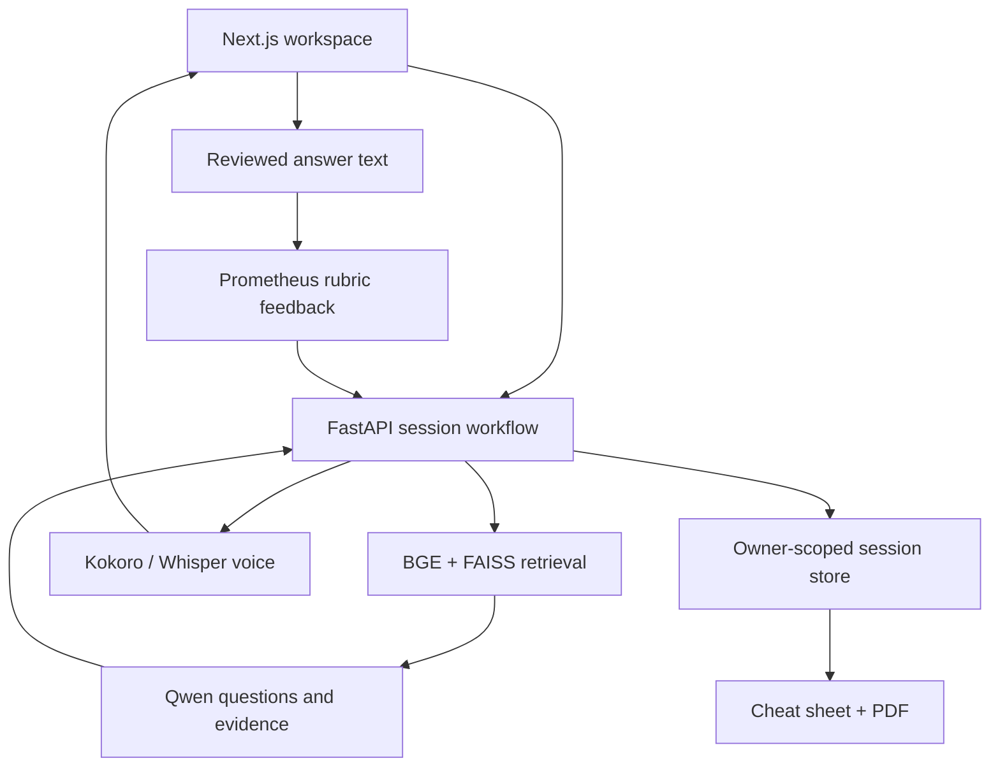

# RoleReady workflow

The product is English interview preparation. It helps a candidate practise; it does not assess employability or predict a hiring decision.

1. The candidate uploads a text PDF, DOCX or TXT CV, or pastes the text. They review the extracted text and add a job description, role and experience level. Scanned PDFs need external OCR.
2. BGE embeds the request and FAISS retrieves role-related questions from the training-only bank. These are examples, not trusted answers. The supplied job description is the actual role requirements source.
3. Qwen receives the CV, job description and retrieved examples. It produces an evidence-based summary and exactly seven distinct questions, criteria and reference guidance. Findings contain exact source quotes. Missing CV evidence is described as “not evidenced,” not proof that the candidate lacks a skill.
4. Kokoro optionally speaks each question. The candidate records up to three minutes or types an answer. Whisper transcribes recordings. The candidate reviews and corrects the text before submitting it.
5. Prometheus receives the question, candidate text, reference answer, expected points and versioned rubric. It returns feedback and one score from 1–5. Accent, identity and inferred personality are outside the rubric.
6. The application saves the answer and feedback. All seven answers are required for the cheat sheet, which compiles the actual feedback and highlights the three lowest-scoring questions for further practice. Changing an answer invalidates the old report.
7. The candidate can resume a saved session, download the PDF, or delete the session.

## Boundaries

Next.js proxies only allowlisted API routes to a fixed backend. The browser never receives model API keys. Hosted use requires Supabase; each request is verified through its user endpoint, and database access uses the user's JWT plus row-level policies. The local workspace is a single-user development mode, bound to localhost, and is not an authentication product.

Uploaded originals and recordings are processed without permanent file storage. Saved sessions contain CV/JD text, original and corrected transcripts, questions and feedback. Model providers necessarily receive the text needed for their task; self-hosted endpoints can keep that processing local. Choose a provider and retention policy before public deployment. The app never adds candidate content to the research bank, training data, Git or MLflow.

SQLite supports local sessions; Supabase Postgres supports hosted sessions. Version checks prevent simultaneous requests overwriting one another. Session deletion removes application records; external provider retention and hosted database backups depend on deployment configuration.

The cheat sheet is compiled from actual session feedback. It does not make another generative call or invent a first-person answer. Stripe, a subscription system, advanced abuse controls and a public production deployment are future milestones.

## Model identities

| Task | Model | Current validation boundary |
| --- | --- | --- |
| Evidence and question generation | `Qwen/Qwen3.5-4B` | Contract tested; real serving endpoint and task evaluation pending |
| Rubric feedback | `prometheus-eval/prometheus-7b-v2.0` | Contract tested; needs human interview calibration |
| Retrieval embeddings | `BAAI/bge-small-en-v1.5` | Real CPU index and exploratory comparison executed |
| English transcription | `Systran/faster-whisper-small.en` | Optional local adapter; actual smoke outcomes in progress log |
| English question audio | `hexgrad/Kokoro-82M` | Optional local adapter; actual smoke outcomes in progress log |

Revisions are pinned in `configs/models.json`. FAISS and MLflow are tools, not extra models. The project uses multiple specialist models; it does not claim that all of them are custom fine-tuned by the team.
